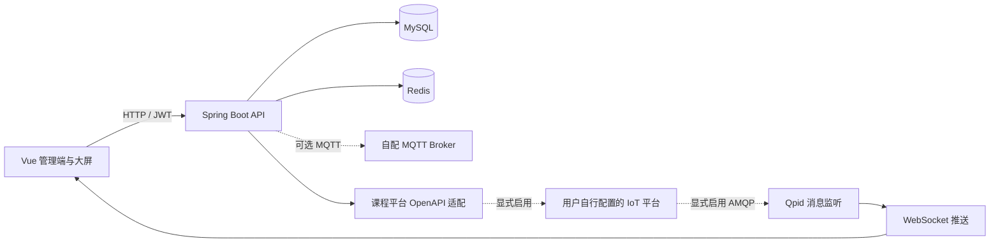

# 智能家居 IoT 实训平台

面向智能晾衣架场景的设备管理与数据展示课程项目，包含 Web 管理端、Java 后端、IoT 平台接口适配和设备消息推送。

这是 **2023 年课程团队实训的源码归档**，由迟凡杰维护。项目基于 RuoYi / Wumei 的管理与物联网代码开展实践；基础平台、第三方组件和团队成员的贡献均保留原有归属，维护者身份不表示所有代码由个人独立完成。

## 项目内容

| 方向 | 仓库中的实现 |
| --- | --- |
| 设备与产品 | 设备、产品、物模型、设备日志、固件、分组及场景管理的前后端代码 |
| 消息与平台对接 | MQTT 客户端；课程平台 AMQP 订阅、WebSocket 推送、设备新增/查询与请求签名 |
| 管理与展示 | 用户/角色/菜单、定时任务、告警记录、图表与智能晾衣架大屏 |
| 数据层 | MyBatis Mapper、MySQL 表结构，以及可选的 TDengine 日志存储代码 |

这些模块说明源码覆盖范围；设备控制与固件下发效果需要相应硬件和平台环境验证。仓库没有附带硬件固件或可访问的课程平台账号。

## 架构



后端 MQTT 自动连接、课程平台 OpenAPI 和 AMQP 监听默认关闭。启用连接必须显式提供配置，不会回连原课程服务器。

## 技术栈与目录

- 后端：Java 8、Spring Boot 2.5.6、Spring Security、MyBatis、Redis、JWT、Quartz。
- 前端：Vue 2、Vue CLI 4、Element UI、ECharts、DataV、Vuex。
- 通信：Eclipse Paho MQTT、Qpid JMS / AMQP、WebSocket；平台签名依赖华为 API Gateway Java SDK。

```text
springboot/
├── jie-admin/         # 启动入口、Web API、应用配置
├── jie-framework/     # 认证与基础框架
├── jie-system/        # 用户、角色、菜单
├── jie-common/        # 公共工具与数据类型
├── jie-quartz/        # 定时任务
├── jie-generator/     # 上游代码生成模块
└── jie-iot/src/main/java/com/ruoyi/
    ├── iot/          # 物联网业务层
    └── iss/          # 课程平台 OpenAPI、AMQP、WebSocket 适配
vue/                  # 管理页面、设备页面与大屏
sql/jie-smart.sql     # 56 张表的结构，不包含账号或业务数据
```

建议阅读：

1. [平台接口适配](springboot/jie-iot/src/main/java/com/ruoyi/iss/open/service/PlatformServiceImpl.java)：从请求模型到设备接口，再到响应转换。
2. [AMQP 监听](springboot/jie-iot/src/main/java/com/ruoyi/iss/qpid/IotApplicationQpidListener.java) → [WebSocket 推送](springboot/jie-iot/src/main/java/com/ruoyi/iss/socket/WebSocketServer.java)：消息接收、异步处理与推送链路。
3. [设备业务服务](springboot/jie-iot/src/main/java/com/ruoyi/iot/service/impl/DeviceServiceImpl.java)与[设备页面](vue/src/views/iot/device/index.vue)：对照前后端接口和设备状态展示。
4. [大屏入口](vue/src/views/bigScreen/home.vue)：页面布局与图表组织。

## 本地复现准备

本次公开整理进行了配置、SQL 和源码的静态检查，**没有安装依赖、编译、启动服务或连接真实设备平台**。下面是根据项目清单整理的步骤，不代表已验证的一键部署流程。

### 1. 工具与 SDK

需要 JDK 8、Maven 3、兼容 Vue CLI 4 的 Node.js/npm 环境，以及本地 MySQL、Redis。前端尚无锁文件，旧工具链与现代 Node.js 的兼容性需要单独验证。

`jie-iot/pom.xml` 通过 `systemPath` 引用 `java-sdk-core-3.2.0.jar`，该第三方二进制未附带。请从有授权的 SDK 来源取得与代码相符的版本，放到：

```text
springboot/jie-iot/src/main/resources/libs/java-sdk-core-3.2.0.jar
```

缺少这个文件时 Maven 构建会失败。父 POM 的 Java 8 `bootclasspath` 使用 Windows 分隔符，以下以 Windows / PowerShell 为例；其他系统需要先调整该配置。

### 2. 数据库

创建仅供本地复现的空数据库 `jie_smart`，在 MySQL 客户端中导入：

```sql
USE jie_smart;
SOURCE /absolute/path/to/smart-home-iot-practicum-2023/sql/jie-smart.sql;
```

脚本仅包含表结构，不执行删除表操作，不创建可登录账号。原业务记录、设备标识、OAuth 数据和账号口令不随源码发布。登录演示前，还需自行建立本地用户、角色、菜单及字典初始化数据；**仓库没有默认用户名/密码**。

### 3. 后端

字段见 [springboot/.env.example](springboot/.env.example)。Spring Boot **不会自动加载这个 `.env` 文件**；请将字段设置为终端或 IDE 的环境变量。必填项为 `DB_USERNAME`、`DB_PASSWORD`、`JWT_SECRET`。

```powershell
$env:DB_USERNAME = Read-Host "本地数据库用户名"
$env:DB_PASSWORD = Read-Host "本地数据库密码"
# 仅供本地实例使用；更换后旧登录令牌失效。
$env:JWT_SECRET = [Guid]::NewGuid().ToString('N') + [Guid]::NewGuid().ToString('N')

cd springboot
mvn -pl jie-admin -am package -DskipTests
java -jar jie-admin/target/jie-admin.jar
```

默认 HTTP 端口 `8080`，MySQL/Redis 指向本机。`-DskipTests` 不表示测试通过，需要认证的接口仍要求完成本地账号与权限初始化。

### 4. 前端

另开终端：

```powershell
cd vue
Copy-Item .env.example .env.development.local
npm install
npm run dev -- --port 8081
```

开发代理把 `/dev-api` 转发到 `http://127.0.0.1:8080`。更改后端端口时，同步修改 `VUE_APP_SERVER_API_URL`。`VUE_APP_*` 会进入浏览器构建，不能填写真实平台私钥或生产管理凭据。

## 按需连接设备服务

| 能力 | 开关 | 配置 |
| --- | --- | --- |
| 后端 MQTT 自动连接 | `MQTT_ENABLED=true` | `MQTT_URL`、`MQTT_USERNAME`、`MQTT_PASSWORD` |
| 课程平台 OpenAPI | `IOT_API_ENABLED=true` | `IOT_API_URL`、`IOT_API_ACCESS_KEY`、`IOT_API_SECRET_KEY`、`IOT_API_CLIENT_ACCOUNT` |
| 课程平台 AMQP | `IOT_AMQP_ENABLED=true` | `IOT_AMQP_URL`、`IOT_AMQP_QUEUE`、`IOT_AMQP_USERNAME`、`IOT_AMQP_PASSWORD`、`IOT_AMQP_TARGET_USER_ID` |
| 浏览器课程消息通道 | 默认不连接 | `VUE_APP_IOT_WEBSOCKET_URL`，填写自配后端 `/im/server/{userId}` 对应的完整 WebSocket 地址 |
| TDengine | `TDENGINE_ENABLED=true` | `TDENGINE_URL`、`TDENGINE_USERNAME`、`TDENGINE_PASSWORD`、`TDENGINE_DATABASE` |

AMQP 适配将消息投递给一个显式配置的目标用户，尚未实现完备的设备归属路由。浏览器消息到设备状态的映射保留实训逻辑，需结合实际报文调试。EMQX 管理页继承了上游从浏览器调用管理接口的方式，仅适合隔离的本地实验；实际部署前需增加服务端代理与访问控制。

## 当前边界

- 尚未完成依赖复现、端到端测试或公开演示部署；缺失的 SDK 和本地初始化数据需要准备。
- 第三方登录、地图、固件发布等服务不随源码提供，未配置时不能期待完整交互效果。
- WebSocket 身份校验、消息权限、设备状态映射与旧依赖升级仍需完善，不宜直接用于生产。
- 登录页只记住账号，不在浏览器保存可解密的密码。媒体素材需要按来源确认复用权限。

## 来源与许可

上游声明保留在[后端 README](springboot/README.md)、[后端 MIT LICENSE](springboot/LICENSE)和[前端 package.json](vue/package.json)中。前端清单保留 `wumei-smart` / `kerwincui` 与 `GPL3.0` 声明，后端原有 MIT 声明保留 RuoYi 版权。

本仓库不以新的根许可证覆盖上述不同来源，也不把上游基础平台重新声明为个人原创。复用和再分发时，应核对具体组件的上游版本、许可正文及素材授权。团队职责以真实协作记录为准，本文不推定个人独立完成范围。
